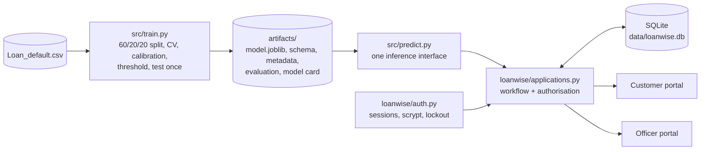

# Loan Default Risk Predictor + LoanWise

An end-to-end, **educational** machine-learning project: a leakage-safe training pipeline for loan default risk, per-applicant explanations, and **LoanWise**, a small two-portal web app (customer and bank officer) built around the model.

> **Not a lending system.** This is a portfolio project. It is not a bank, not a lender, and not a validated or regulatory-compliant credit-decision tool. A model score never approves or rejects anyone; in LoanWise only a human officer can record a decision, with a reason.

## What is in the repository

| Part | Entry point | What it is |
|---|---|---|
| ML pipeline | `python -m src.train` | Leakage-safe training, evaluation, calibration, versioned artifacts, generated model card |
| **LoanWise** | `streamlit run app/loanwise_app.py` | Landing page with a **Customer portal** and a **Bank officer portal**, SQLite persistence, role-based access |
| Original analytics app | `streamlit run app/app.py` | The first version of the dashboard (uses the older files in `models/`; kept for reference) |

## Architecture



Design decisions that matter:

* **One pipeline, raw columns in, probability out** (`src/pipeline.py`). The app never re-implements feature engineering, so training and serving cannot drift apart.
* **Authorisation lives in the service layer.** Every `ApplicationService` method takes the session token and re-validates it; Streamlit pages only call the service, so hiding a menu item is never the security boundary.
* **Customers are isolated**: asking for another customer's application returns `NotFound`, indistinguishable from a missing record.
* **Model output is information, not a decision.** Statuses `Approved`/`Rejected` exist only as a recorded human decision with a mandatory reason; officer notes and names are never shown to customers.

## Run it locally (Windows / VS Code)

```powershell
# from the project folder
python -m pip install -r requirements-dev.txt
python -m unittest discover -s tests -t .      # run the automated tests
python -m src.train                            # train; writes artifacts/ (about 3-5 minutes)
$env:LOANWISE_DEMO_MODE = "1"                  # optional: shows the demo account on the login page
python -m src.loanwise.seed_demo               # optional: ~40 clearly flagged SYNTHETIC applications
streamlit run app/loanwise_app.py
```

* Officer accounts are never self-registered. Create one with `python -m src.loanwise.create_officer`.
* Demo accounts and their fixed demo password exist **only if you run `seed_demo`**, are for local use, and are labelled as demo data in the app. Do not seed a public deployment.
* The database is `data/loanwise.db` (override with `LOANWISE_DB`). It is git-ignored. On Streamlit Community Cloud the file system is ephemeral, so records there do not persist across redeploys; use a hosted database for anything real.

## Model results (held-out test set, touched once)

From `artifacts/model_card.md` for the documented run (255,347 rows, 11.6% defaults, seed 42; your numbers can differ slightly with other library versions):

| Measure | Value |
|---|---|
| Selected model | Logistic Regression (simplest model within one standard error of the best) |
| ROC-AUC | 0.7616 (95% bootstrap CI 0.7557 to 0.7675) |
| PR-AUC | 0.336 (a no-skill model scores about 0.116) |
| Brier score | 0.0903 (always predicting the base rate: 0.1026) |
| Calibration error (ECE) | 0.0036 |
| At threshold 0.142 (precision-maximising subject to recall >= 0.60) | precision 0.258, recall 0.613, flags 27.6% of applicants |

Cross-validated ROC-AUC on the training split: Logistic Regression 0.7556, HistGradientBoosting 0.7513, Random Forest 0.7469. The differences between the top models are small. XGBoost and LightGBM are included as optional candidates and are used automatically when installed.

## Limitations and responsible use

* **The dataset appears synthetic.** Its numeric columns are almost perfectly uniform (checked in `src/schema.py`), so these results say little about real lending behaviour.
* **Sensitive inputs.** Age, marital status and education are model inputs, and age is the strongest driver. Many jurisdictions restrict such attributes in credit decisions, and removing them would not remove proxy effects. **No fairness assessment was possible** (no protected-group outcome data).
* **Probabilities** are calibrated on one validation split of this dataset only; the debt-to-income definition used for the form is an assumption because the data does not document its own.
* **Explanations** show how the model uses its inputs. They are association, not causation, and do not show how to change an outcome.
* All applicant data in LoanWise is self-reported and unverified. Interest rates are user assumptions, not lender offers.
* Hyperparameters are fixed regularised values, not extensively tuned. There is no time-based validation or drift history.

## Testing status

* The ML pipeline and the whole LoanWise service layer (authentication, sessions, lockout, access control, workflow, audit trail, persistence, batch CSV handling, attribution, reports, demo seeding) are covered by automated `unittest` tests.
* The **Streamlit pages have no automated tests.** They are thin and call only the tested service layer, but they should be checked by hand after any change (sign in to each portal, run an assessment, review and decide an application).
* There is no FastAPI layer, Docker setup or live drift monitoring yet.

## Project layout

```
app/                  app.py (original dashboard), loanwise_app.py (LoanWise entry point)
src/
  config.py schema.py features.py pipeline.py evaluate.py train.py predict.py attribution.py synthetic.py
  loanwise/           auth.py security.py db.py applications.py forms.py finance.py assess.py
                      batch.py reports.py demo.py ui/ (landing, customer, officer, theme)
artifacts/            generated by `python -m src.train` (model, schema, metadata, evaluation, model card)
tests/                unit and integration tests (synthetic data only)
AUDIT.md              audit of the original project: what was wrong and what changed
```
